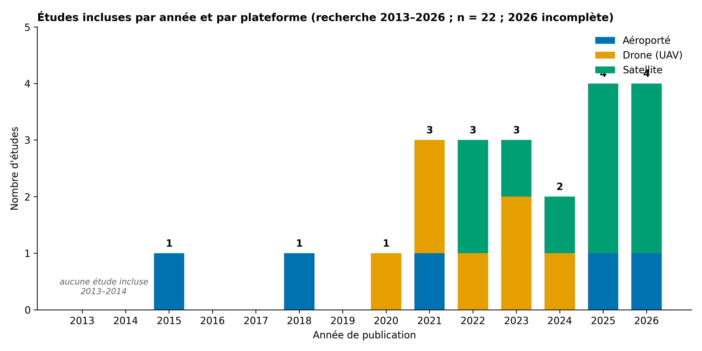
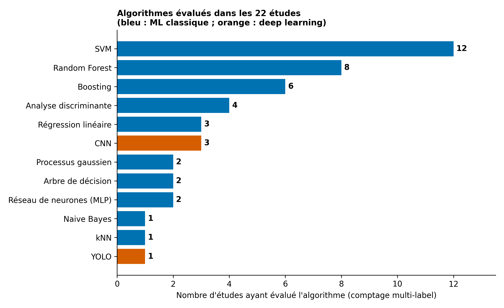
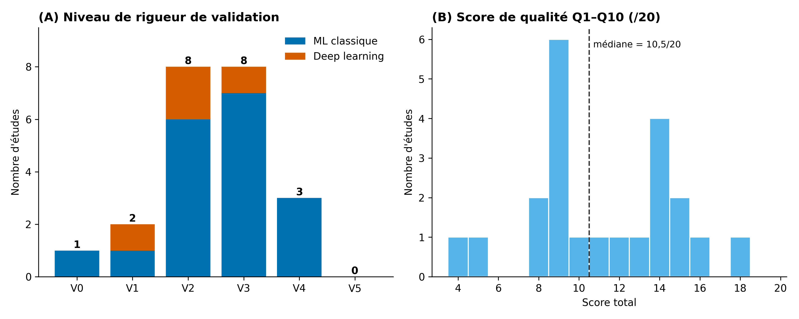

# Lab 9 : Analyser les études et identifier les Research Gaps (PRISMA 2020)


**Revue systématique :** *Machine learning and remote sensing for disease and stress detection in olive (Olea europaea L.)*  
**Corpus :** **22 études** (**23 rapports**) incluses après évaluation du texte intégral (Scopus et Web of Science Core Collection, recherche du 15 novembre 2026, période 2013–2026).

---

## 1. Introduction

Ce dépôt implémente l'intégralité des **13 étapes et 2 défis pratiques du Lab 9** afin de transformer la grille d'extraction et l'évaluation de qualité des 22 études incluses (Lab 8) en une synthèse analytique reproductible : tableau comparatif, statistiques descriptives par métrique, visualisations haute résolution (300 dpi), extraction lexicale des limitations par n-grammes, identification des limitations récurrentes ($\ge 3$ études), formulation de *Research Gaps* argumentés et proposition de pistes de recherche futures testables.

**Objectifs du lab :**
1. Classer les études par approche (ML classique / deep learning), modalité capteur, plateforme et cible ;
2. Comparer les performances rapportées sans les agréger abusivement (tâches et métriques hétérogènes) ;
3. Distinguer une limitation isolée d'un *research gap* global (limitation récurrente présente dans $\ge 3$ études) ;
4. Formuler des *research gaps* argumentés et des pistes de recherche futures opérationnelles.

---

## 2. Prérequis

* **Python $\ge$ 3.10** (compatible Python 3.10, 3.11, 3.12, 3.13).
* Bibliothèques listées dans `requirements.txt` : `pandas`, `numpy`, `scipy`, `matplotlib`, `pytest`.
* Exécution 100 % autonome hors-ligne : toutes les données sources sont versionnées dans `data/`.

---

## 3. Installation, exécution et tests

```bash
git clone https://github.com/amina-moueddene/PRISMA2020-Lab9.git
cd PRISMA2020-Lab9
python3 -m venv .venv && source .venv/bin/activate      # optionnel
pip install -r requirements.txt

# Exécuter le pipeline complet (génère tous les livrables de output/)
python3 scripts/analyze_and_gaps.py

# Options CLI disponibles (--data-dir, --output-dir, --quiet)
python3 scripts/analyze_and_gaps.py --data-dir data --output-dir output --quiet

# Exécuter les 23 tests unitaires, d'intégration et de concordance
python3 -m unittest discover -s tests -v
```

---

## 4. Structure du dépôt

```text
PRISMA2020-Lab9/
├── .github/
│   └── workflows/
│       └── tests.yml                          # Intégration continue GitHub Actions (Python 3.10–3.12)
├── .gitignore
├── pyproject.toml                             # Configuration projet et suite de tests
├── requirements.txt                           # Dépendances Python
├── README.md                                  # Documentation complète du Lab 9
├── data/                                      # Données sources (issues du Lab 8)
│   ├── fulltext_extraction_22_studies.csv     # Extraction du texte intégral (28 variables)
│   ├── quality_assessment_Q1-Q10.csv          # Scores méthodologiques Q1–Q10 (/20)
│   ├── studies_master_v2.csv                  # Variables normalisées (plateforme, cible, V, DRL, métriques)
│   └── lab8_consolidated_extraction_qa.csv    # Grille consolidée du Lab 8
├── scripts/
│   └── analyze_and_gaps.py                    # Pipeline typé, validé et configurable par CLI
├── output/                                    # Livrables générés automatiquement
│   ├── tableau_comparatif.csv                 # Tableau comparatif des 22 études (CSV)
│   ├── tableau_comparatif.md                  # Tableau comparatif formaté (Markdown)
│   ├── statistiques_performances.csv          # Statistiques par métrique, approche et validation
│   ├── tendances_annuelles.png                # Évolution annuelle des publications (300 dpi)
│   ├── top_modeles.png                        # Répartition multi-label des algorithmes (300 dpi)
│   ├── validation_et_qa.png                   # Niveaux V0–V5 et distribution QA (/20) (300 dpi)
│   ├── limitations_frequentes.csv             # Top 15 des bigrammes extraits des limitations
│   ├── potential_gaps.csv                     # Limitations récurrentes (≥ 3 études) et priorités
│   ├── research_gaps_et_pistes.md             # Rapport structuré des 3 Gaps et 3 pistes futures
│   ├── synthese_lab9.json                     # Synthèse statistique complète (audit automatisé)
│   └── verification.md                        # Réponses détaillées aux questions Q1–Q3 et Défis 1–2
└── tests/
    └── test_lab9.py                           # Suite de 23 tests (unitaires, intégration, CLI, concordance)
```

---

## 5. Correspondance complète entre les étapes du lab et les livrables

| Étape | Contenu du lab | Implémentation (`scripts/analyze_and_gaps.py`) | Livrable généré |
| :-: | :-- | :-- | :-- |
| 1 | Introduction et prérequis | Documentation projet | `README.md` (§§ 1–3) |
| 2 | Chargement et validation du fichier d'extraction | `load()`, `validate_input_dataframe()` | DataFrame validé (22 études) |
| 3 | Nettoyage et structuration des données | `load()`, `clean_text()` | Colonnes normalisées |
| 4 | Classification par méthode, modalité, plateforme et cible | `load()` (`TARGET_DETAIL`, `ALGOS`, `XAI`, `LEAKAGE`) | `Cible_détaillée`, `Algorithmes`, `Explicabilité` |
| 5 | Construction du tableau comparatif | `comparative_table()` | `output/tableau_comparatif.csv`, `.md` |
| 6 | Analyse des métriques et performances | `performance_stats()` | `output/statistiques_performances.csv` |
| 7 | Visualisation des tendances temporelles | `figures()` | `output/tendances_annuelles.png` |
| 8 | Visualisation de la répartition des modèles et QA | `figures()` | `output/top_modeles.png`, `output/validation_et_qa.png` |
| 9 | Identification des limitations récurrentes (n-grammes) | `clean_limitation_text()`, `get_ngrams()`, `gaps()` | `output/limitations_frequentes.csv` |
| 10 | Limitation individuelle vs research gap global ($\ge 3$ études) | `gaps()` | `output/potential_gaps.csv` |
| 11 | Formulation de research gaps argumentés (**Défi 1**) | `write_research_gaps_and_pistes()` | `output/research_gaps_et_pistes.md`, `output/verification.md` |
| 12 | Rédaction des pistes de recherche futures (**Défi 2**) | `write_research_gaps_and_pistes()` | `output/research_gaps_et_pistes.md`, `output/verification.md` |
| 13 | Vérification (questions Q1–Q3 et Défis 1–2) | Audit complet | `output/verification.md` |

---

## 6. Aperçu des visualisations générées (Étapes 7 et 8)

### Évolution temporelle par plateforme (`output/tendances_annuelles.png`)


### Algorithmes évalués dans les 22 études (`output/top_modeles.png`)


### Rigueur de validation et distribution des scores QA (`output/validation_et_qa.png`)


---

## 7. Synthèse quantitative du corpus (Étapes 2 à 8)

* **Corpus :** 22 études publiées entre 2015 et 2026 (3 en 2015–2020, 9 en 2021–2023, 10 en 2024–2026, période incomplète) ; 19 articles de revue et 3 communications de conférence.
* **Plateformes :** Satellite (10), Drone / UAV (7), Aéroporté (5).
* **Modalités :** Multispectral (11), Multimodal (6, dont 4 hyperspectral + thermique), RGB (3), Hyperspectral seul (2).
* **Cibles :** Pathogènes vasculaires (11 : *Xylella fastidiosa* 4, *Verticillium dahliae* 5, les deux 2), stress hydrique / sécheresse (7), maladies foliaires (2), stress mixte biotique/abiotique (2).
* **Familles d'IA :** Machine Learning classique (18 études) vs Deep Learning (4 études : CNN ×3, YOLOv5 ×1).
* **Validation (`V0`–`V5`) :** `V3` (8), `V2` (8), `V4` (3), `V1` (2), `V0` (1), `V5` (0).
* **Qualité méthodologique (`Q1`–`Q10` / 20) :** médiane **10,5/20** (IQR 9,0–14,0 ; étendue 4–18 ; moyenne 11,14) ; médiane **12,0/20** pour le ML classique contre **8,5/20** pour le Deep Learning.
* **Corrélation performance / validation :** sur les 12 études rapportant une OA/Accuracy, la précision diminue fortement lorsque la rigueur de validation augmente (Spearman $
ho = -0,70$, $p = 0,011$ ; médiane **0,96** en `V0`–`V2` contre **0,80** en `V3`–`V4`).

---

## 8. Research Gaps argumentés (Étape 11 — Défi 1)

1. **Gap 1 — Déficit de tests de transfert spatio-temporel et exposition aux fuites de données :** 19 études sur 22 (86,4 %) n'évaluent aucun transfert explicite inter-sites ou inter-années (`V0`–`V3`), et 14 études (63,6 %) présentent au moins une voie potentielle de fuite de données. Parmi les 3 études `V4`, D'Addabbo et al. (2025) observent un effondrement du rappel à **0,10** lors du transfert inter-zones, et Garofalo et al. (2024) rapportent l'échec du transfert inter-annuel.
2. **Gap 2 — Faiblesse de la vérité terrain biologique et physiologique :** 15 études sur 22 (68,2 %) reposent sur des relevés visuels ou des annotations d'images sans confirmation moléculaire (qPCR/PCR) ni mesure physiologique directe ; aucune des 4 études de Deep Learning ne dispose d'une validation biologique de laboratoire.
3. **Gap 3 — Confusion physiologique entre infection vasculaire et déficit hydrique :** 11 études sur 22 (50,0 % — 100 % des travaux sur pathogènes vasculaires) ne dissocient pas expérimentalement l'infection (*Xylella fastidiosa*, *Verticillium dahliae*) du stress hydrique abiotique.

---

## 9. Pistes de recherche futures (Étape 12 — Défi 2)

1. **Piste 1 — Évaluation par blocs spatio-temporels (`leave-orchard-out`, `leave-region-out`, `leave-season-out`) :** quantifier la chute de généralisation hors domaine avec prétraitements et rééquilibrage appliqués strictement après séparation.
2. **Piste 2 — Protocole de référence stratifié confirmé par qPCR et chambre à pression :** combiner tests qPCR sur arbres asymptomatiques, double notation visuelle ($\kappa$ inter-observateurs) et mesure du potentiel hydrique de tige.
3. **Piste 3 — Plan factoriel croisé Infection × Régime d'irrigation :** dissocier expérimentalement arbres sains en déficit hydrique et arbres infectés en intégrant des séries temporelles satellitaires comme covariable hydrique.
